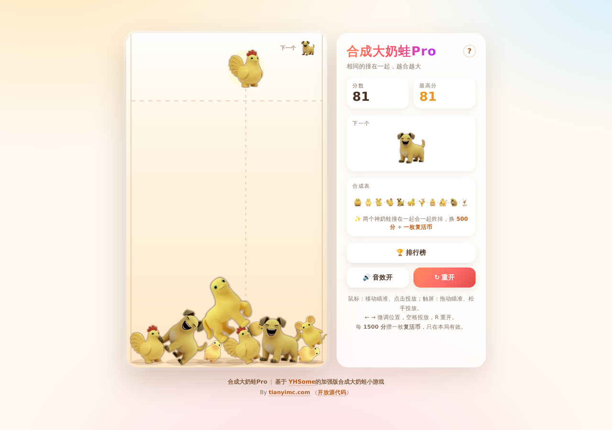

# 合成大奶蛙Pro

纯 **HTML + CSS + JavaScript** 的静态网页小游戏，零依赖、零构建、离线可玩。
物理引擎（PBD 位置约束求解）是自己写的，没有引入 matter.js 等任何第三方库。

这是「合成大奶蛙」的 **Pro 续作**：在原作者版本的基础上追加了连锁、合成图鉴、
局内统计、危险线救回、方向微调、两档复活、玩法教程等玩法。

## 仓库

- 本仓库：**<https://github.com/tianyimc/BigNaiWa-Pro>**
- 纯静态页面，没有构建步骤，也不需要后端。
- 本项目目前**没有对外公布的线上地址**；部署由仓库拥有者自行决定，本文档不提供直玩链接。
  想玩请按下面的「运行」一节在本地打开。



## 玩法

- **鼠标**：移动瞄准，点击即投放。
- **触屏**：按住拖动瞄准，**松手才投放**——手指不会挡住落点，也方便微调。
- 棋盘右上角的「下一个」是**下一颗**；当前这颗画在准星位置（虚线顶端）。
  投放后的冷却期间当前这颗会**变淡**显示（还不能投），这样两个位置始终各是各的，不会看混。
- 两个**同级别**的奶蛙碰到一起就合成为高一级，并获得分数。
- 顶上虚线是**警戒线**：有水果**卡在线的上方并且基本停住**、累计超过 1.5 秒即判负
  （被弹起来飞过线的不算，详见下面的「失败规则」）。
- 标题旁边的 **`?`** 按钮随时打开**玩法教程**（Esc 或点空白处关闭）。
- 结束后结算面板会列出**本局亮点**：最高连锁、最高等级、顶级清场、危险救回、用掉的复活币。
- 排行榜目前是**占位状态**（显示「正在完善中，敬请期待」，不发任何网络请求）。
- `←` `→` 微调位置，`Space` / `Enter` 投放，`R` 重新开始。
  `Shift` + `←`/`→` 给一点**投放方向微调**（见下）。
  （结束后空格/回车不再重开，避免手快连开新局。）

### 连锁（cascade）

普通合成会产出一颗新水果。如果**这一颗新水果**在 **600ms** 内又被另一次合成吃掉，
而且两次合成之间玩家没有投放过，就算接上了一环：

- 第一次合成 = 连锁长度 1，之后每接上一环 +1；
- 不相干的合成会另起一条，从 1 重新开始；
- **玩家一投放，当前连锁立即结算**；
- 两只神奶蛙相撞不产出水果，所以它会**结束**连锁，也不计入连锁长度
  （但仍会累加「顶级清场」统计）。

连锁结束时飘一个 `×N 连锁`（最多显示 `×5+`，统计里保留真实值），
并按 `min(长度-1, 5) × 5` 加分，**最多 +25**。这笔奖励**不攒复活币**。

### 危险线救回

同一颗水果在警戒线上方累计满 **0.5 秒**后，如果它掉回线下、或被合成掉，
就记一次「救回」并 **+30 分**：

- 只是被弹飞路过线上方的（没攒够 0.5 秒）不算；
- 同一颗只记一次，每局最多记 **3 次**；
- 救回奖励同样**不攒复活币**（防止靠危险线刷分刷币）。

### 投放方向微调

瞄准位置永远只由 `aimX` 决定，方向微调只是松手时额外给一点点横向速度：

- 键盘：`Shift` + `←`/`→`，每按一次 ±20 px/s；
- 触屏：用拖动**最后 120ms** 的横向甩动速度，慢慢挪不算；
- 上限 **±60 px/s**（下落速度仍是 130 px/s），有冲量时准星下方会出现小箭头；
- 力度刻意压得很小，**不能替代瞄准**。不想要这个功能就把
  `game.js` 里的 `FINESSE_ENABLED` 改成 `false`。

### 合成图鉴

合成表里没解锁过的等级显示为 `?` 剪影。第一次合出某个等级时解锁它，
记录存在 `localStorage`（`danaiwa.discovery.v1`），**跨局保留**。
图鉴纯外观，不影响掉落概率、物理、分数或复活进度。

合成链（11 级）：

```
葡萄 → 樱桃 → 橘子 → 柠檬 → 猕猴桃 → 番茄 → 桃子 → 菠萝 → 椰子 → 半奶蛙 → 神奶蛙
```

合成得分采用三角数：1 / 3 / 6 / 10 / 15 / 21 / 28 / 36 / 45 / 55，
两只神奶蛙撞在一起会一起炸掉，额外加 500 分、并送一枚复活币（后期唯一的泄压阀：两只神奶蛙占满棋盘，不炸掉就没法继续玩）。

## 失败规则

**唯一判负条件：有水果卡在警戒线上方、且基本停住，累计超过 1.5 秒。**

```js
const DANGER_Y   = 142;   // 警戒线
const OVER_LIMIT = 1.5;   // 累计秒数
const REST_SPEED = 140;   // 低于这个速度才算“卡住了”（px/s）

for (const b of balls) {
  if (b.dead || !b.landed) continue;         // 还没落地的不算
  if (b.y - b.r < DANGER_Y) {                // 这只在线上面
    if (b.vx*b.vx + b.vy*b.vy < REST_SPEED2) {
      b.overTime += dt;                      // 停住的才计时
      if (b.overTime > OVER_LIMIT) gameOver();
    } else {
      b.overTime -= dt * 2;                  // 正在飞 → 倒扣
    }
  } else {
    b.overTime -= dt * 2;                    // 回到线下方 → 倒扣（2 倍速）
  }
}
```

几个容易被误解的点：

| 疑问 | 答案 |
| --- | --- |
| **好几只轮流在线上方，时间会加在一起吗？** | **不会。** `overTime` 是**每只各自**的变量，必须**同一只**累计满 1.5 秒 |
| **被弹飞、路过线上的算吗？** | **不算。** 速度 ≥ 140px/s 时不计时，而且还在倒扣 |
| **贴着线上下反复弹会攒起来吗？** | 得看比例：线下方按 2 倍速扣，净变化率 = `3f − 2`（`f` = 在线上方的时间占比），**只有 f > 2/3 才攒得起来** |
| **会不会永远输不了？** | 不会。实测灌满棋盘第 161 次投放判负，那时堆顶 y=45、线上方 4 只里 3 只是静止的 |
| **除了这个还有别的失败条件吗？** | 没有。不限步数、不限数量、不限时间 |

想调：`DANGER_Y` 调高低、`OVER_LIMIT` 调容忍时间、`REST_SPEED` 调“多慢才算卡住”。
`node physics.test.js` 的第 7 组会把这三条规则各验一遍。

## 复活：两档可选

越线判负时，如果手里有复活币，会先弹一屏让你选：

| 档位 | 花费 | 清掉什么 |
| --- | --- | --- |
| 普通 | **1 枚** | 最顶上 1 颗 + 所有还压在警戒线以上的 |
| 大范围 | **2 枚** | 最顶上 3 颗 + 所有还压在警戒线以上的 |

两个条件会**取并集**：同一颗水果即使同时满足「在最顶上」和「越线」也只清一次。
余额不足 2 枚时大范围档会**变灰禁用**，并提示还差几枚；「不了，结束吧」永远可用。
复活后越线计时清零，接着玩。

复活币每累计 **1500 分**发一枚，只在本局有效（重开清零）。

## 运行

本地双击 `index.html` 即可（`file://` 协议下也能跑）。
也可以起个静态服务（推荐，行为更接近真实环境）：

```bash
python -m http.server 8080
# 打开 http://localhost:8080
```

根目录就是站点根目录：`index.html`、`game.js`、`style.css`、`assets/` 都在这里，
仓库里还放着 `.nojekyll`，静态托管会原样发布。

`v1/` 只保留一个**兼容跳转页**，把旧链接带到根页面，里面没有游戏代码。

> 部署与否由仓库拥有者决定，本仓库不附带线上地址。

## 文件

| 文件 | 说明 |
| --- | --- |
| `index.html` | 页面结构：棋盘、结束遮罩、侧边面板、排行榜弹窗 |
| `style.css` | 全部样式：玻璃拟态面板、响应式布局、结束动画、排行榜 |
| `game.js` | 游戏逻辑 + 自研物理 + Canvas 渲染 + WebAudio 音效 |
| `leaderboard.js` | 排行榜源码（TinyWebDB 接口 + 弹窗渲染 + 昵称屏蔽词） |
| `leaderboard.min.js` | 页面实际引用的排行榜副本（手工与 `leaderboard.js` 同步，**不是**自动构建产物） |
| `assets/fruits/` | 水果贴图：`*.png` 是 512×512 的源图，页面实际加载的是 `*.webp`；另有 `parts.js` 碰撞形状、`blur.js` 极模糊占位图 |
| `tools/normalize_assets.py` | 素材统一脚本：抠底、去噪、统一画布、烤暗边 |
| `tools/optimize_sprites.py` | 把源图压成 WebP 并裁到每级实际需要的尺寸（1.45 MB → 0.19 MB） |
| `tools/make_blur.py` | 生成极模糊占位图 `blur.js`（11 张缩略图拼成一条、内联成 data URL，约 8 KB） |
| `tools/build_parts.py` | 按贴图轮廓生成碰撞形状，产出 `assets/fruits/parts.js` |
| `src/` | 原始素材（11 张，格式/尺寸/底色都不统一），只作为脚本输入 |
| `physics.test.js` | 物理手感自检脚本（`node physics.test.js`） |
| `gameplay.test.js` | 复活 / 清场玩法自检（`node gameplay.test.js`） |
| `name-filter.test.js` | 排行榜界面 + 昵称屏蔽词 + 离线占位自检（`node name-filter.test.js`） |
| `stage2.test.js` | 连锁 / 局内统计 / 图鉴 / 危险线救回 / 方向微调 / 复活二选一自检（`node stage2.test.js`） |
| `help.js` | 玩法教程弹窗：开关、焦点管理与 Escape 关闭，不触碰游戏状态 |
| `stage3.test.js` | 教程 / 改名 / 页脚 / 赞助移除自检（`node stage3.test.js`） |
| `v1/index.html` | 兼容跳转页：把旧的 `/v1/` 链接带到根页面，没有游戏代码 |
| `v1/fd46d3bf08af562b46f4afcdd8134ffc.txt` | 微信网站验证文件（保留旧路径，根目录也有一份） |
| `preview.png` | 预览图（1280×900，由无头浏览器截取的实际游戏画面） |

## 排行榜（当前：占位状态）

**排行榜目前是关闭的。** 两处入口按钮照常打开弹窗，弹窗里只显示一句
**「正在完善中，敬请期待」**，并且**不发任何网络请求**：不读榜、不提交成绩、不重试。

- 联网开关在 `leaderboard.js` / `leaderboard.min.js` 顶部：`let ONLINE_ENABLED = false;`
- 改成 `true` 就恢复下面的完整逻辑（网络代码一行都没删）；
- 运行期也能切换：`DanaiwaBoard.setOnline(true)` / `.setOnline(false)`；
- 排行榜源码与压缩副本都保留在仓库里，没有删除。

下面记录的是**恢复联网后**的行为，留着备查。

用的是 **TinyWebDB**（`https://tinywebdb.appinventor.space/api`）——一个给 App Inventor 用的
极简 key-value 云存储，靠 POST 表单调用，跨域头是 `Access-Control-Allow-Origin: *`，
所以**纯静态页也能直接读写**，不需要自建后端。

| 项 | 值 |
| --- | --- |
| 接口 | `POST https://tinywebdb.appinventor.space/api` |
| 账号 | `user` / `secret` 以编码形式存在，运行时还原 |
| 用到的 action | `update`（写）、`search`（按 tag 前缀读） |
| tag | `dnw_<时间戳36进制>_<随机4位>` |
| value | `{"n":"昵称","s":分数,"t":时间戳}` |

**榜单内容 = 最近 20 次提交**。服务端按提交时间倒序返回，所以只要拿最新两页
（`no=1` 和 `no=101`）就够覆盖这 20 条，再多请求也没意义；取回来之后在窗口内按分数排名展示。
这个设计的用意是：**榜单是一条滚动的时间窗，不是历史最高分榜**——分数只在自己还在窗口里的
那段时间有效，后来的人会不断把你挤出去，所以卡在榜首或者长期占位没有意义。

```js
// 提交
POST user=<你的 user>&secret=<你的 secret>&action=update
     &tag=dnw_mukuffr8_435q
     &value={"n":"奶娃大王","s":4321,"t":1759000000000}

// 读榜（只要最新两页）
POST user=<你的 user>&secret=<你的 secret>&action=search&no=1&count=100&tag=dnw_&type=both
→ {"dnw_mukuffr8_435q":"{\"n\":\"奶娃大王\",\"s\":4321,\"t\":1759000000000}"}
```

**结算流程**（打完自动上榜，不需要手动点提交）：

1. 游戏结束 → 直接提交，昵称取 `localStorage` 里存的，**没填就用「默认用户」**；
2. 提交成功 → 重新读一次榜单，把窗口内的排名显示出来；
3. 提交失败 → 显示错误并给一个「重试提交」按钮。

排行榜从头到尾**只写自己那条记录，不读也不动别人的数据**：没有任何 `delete`，
旧成绩是自然被挤出时间窗的，不是被清掉的。

昵称在排行榜弹窗顶部的「我的昵称」里随时能改（`change` / `blur` / 回车时落盘）。

实现上的几个小处理：

- **昵称**存 `localStorage`（`danaiwa.name`），去掉控制字符、限长 12 字，空串一律当「默认用户」；
- **防手抖**：自动提交时校验「两次提交至少间隔 3 秒」，0 分不上榜，
  分数明显离谱（> 99999999）的不收；
- **不抢按键**：焦点在输入框里时，`game.js` 的键盘处理直接让路（不然打字会掉水果）；
- **容错**：网络不通只是排行榜打不开，游戏照常玩；接口偶发 502 会自动重试一次；
  返回不是 JSON 会给出可读的错误提示；
- **XSS**：榜单全部用 `textContent` 渲染，不拼 HTML；
- 榜单是最近 20 次提交（最新两页足够覆盖），弹窗底部有标注。

换账号：改排行榜源码顶部的 `USER` / `SECRET` / `PREFIX` 即可（换 `PREFIX` 相当于另开一个榜）。

> **注意**：仓库里**没有**自动压缩脚本（早期文档提到的 `tools/minify-leaderboard.py`
> 并不存在）。页面实际引用的是 `leaderboard.min.js`，它是 `leaderboard.js` 的
> **手工同步副本**——改了源码必须手动把同样的改动同步进去，否则两者会不一致。
> 自检脚本可以分别验证两份文件：`node name-filter.test.js`（默认测 min 版）、
> `node name-filter.test.js leaderboard.js`（测源码版）。

## 碰撞形状（不是圆）

**每个水果的碰撞箱按贴图轮廓来**：`tools/build_parts.py` 读 `assets/fruits/*.png` 的 alpha，
用一组**内接小圆**铺满轮廓，写出 `assets/fruits/parts.js`：

```js
window.SUIKA_PARTS = [ { rb: 1.083, parts: [[0.012,-0.31,0.42], ...] }, ... ];
// parts = [ox, oy, s]，单位是「以 r 为 1」；rb = 包围圆半径（快速粗筛用）
```

游戏里球的碰撞就是这些子圆：

| 环节 | 做法 |
| --- | --- |
| 粗筛 | 两个水果的包围圆 `rb` 不相交直接跳过 |
| 球球 | 子圆两两求交，取**最深/最近的那一对**产生法线与修正量，推力按逆质量分配到刚体中心 |
| 合成 | 任意一对子圆「贴上」（含 0.8px 容差）即合成 |
| 撞墙 | 每个子圆各自贴墙，取各方向最深穿透量一次性加到刚体中心上 |
| 旋转 | 子圆跟着刚体 `angle` 一起转，所以形状会随滚动改变落点 |

圆一律取**内接**（半径 = 到轮廓的欧氏距离，用 chamfer 距离变换算），
所以**不会出现"看不见的碰撞"**；覆盖率不够的地方再贪心补圆，覆盖率到 97% 就提前收工。

实测贴合度（IoU，1.0 = 与图片完全一致）：

```
tier  0   1   2   3   4   5   6   7   8   9  10
IoU .94 .96 .95 .92 .85 .90 .81 .96 .94 .96 .78   ← 平均 0.91
超出轮廓 ≤1.2%（几乎为零）  圆个数 9~16（形状简单自动用更少）
```

`parts.js` 缺失或某级没数据时，自动退回成单圆（半径 r），行为与旧版一致，不会白屏。

重新生成（换了贴图之后跑一次）：

```bash
python tools/build_parts.py --max-parts 16 --preview
# --preview 会导出 _parts_preview.png：红=图片轮廓 绿=碰撞箱 黄=重合
```

成本：12~30 个水果在场时，整套物理每帧 **0.14~0.34 ms**（60fps 预算是 16.7ms）。

## 素材（换图）

11 级各对应 `assets/fruits/NN-<名字>.png` 一张，**棋盘、下一个预览、合成表、粒子全部复用同一张**，
不需要做多倍图（不同尺寸由 canvas 缩放）：

```
01-grape       02-cherry    03-orange   04-lemon    05-kiwi      06-tomato
07-peach       08-pineapple 09-coconut  10-halfmelon 11-watermelon
```

规格：**正方形、透明底、主体居中占长边 92%**，贴图会跟着水果一起滚动/旋转。

**页面加载的是 `.webp`，`.png` 只是给工具用的源图。** 源图统一是 512×512，但打包时会按每一级
在游戏里的实际显示尺寸裁到刚好（最小的葡萄只要 76×76），再用有损 WebP q88 压一遍：
**1.45 MB → 0.19 MB**。这一步不能省 —— 贴图一共才 11 张，原来在慢网下要好几秒才出图，
这几秒里玩家看到的是兜底的程序化水果（一堆卡通脸），反馈就是"图挂了"。

```bash
python tools/optimize_sprites.py            # 默认 q88，会打印每一张的体积对比
python tools/optimize_sprites.py --lossless # 想完全无损就用这个（0.59 MB）
```

换完贴图后注意两点：跑一次 `optimize_sprites.py` 生成新的 `.webp`；
碰撞形状是按源图 alpha 算的，所以还要跑一次 `tools/build_parts.py`。

另外 `game.js` 的 `loadSprites()` 对每张图**失败会退避重试 3 次**（弱网下一次拉不到很常见），
全部失败才回退，不影响玩。

**回退顺序是三级**，别让玩家看到"图挂了"：

1. 贴图到位 → 正常画
2. 还没到 / 失败了 → 画 `blur.js` 里那张**极模糊的同形状缩略图**（内联 data URL，零请求），
   观感是"图正在慢慢变清晰"
3. 连 `blur.js` 都没有（被拦了）→ 才画程序化的圆形水果（那堆卡通脸）

```bash
python tools/make_blur.py     # 换了贴图之后跑一次，重新生成 blur.js
```

换图的两种方式：

1. **偷懒**：直接把新图命名成上面的文件名丢进 `assets/fruits/` 覆盖即可
   （脚本已经统一过格式，直接可用）。
2. **正规**：把 11 张原始图按 `src/1..11.*`（jpg/png/webp 混着都行）放好，然后跑

```bash
python tools/normalize_assets.py
```

脚本会：从四边向内**区域生长抠底**、丢掉零碎噪点、填掉主体内部小孔、
裁剪并按长边 92% 居中到统一画布、最后在主体底下**烤一圈柔和暗边**
（浅色角色在奶油色棋盘上才分得清，运行时零开销），并把每级的平均色打印出来
（可填进 `FRUITS` 的 `pc1/pc2` 作为粒子颜色）。

三道闸门可按图切换，`tools/normalize_assets.py` 顶部 `CFG` 里逐张配置：

| 闸门 | 作用 | 用在 |
| --- | --- | --- |
| `sat_max` | 饱和度高于它的像素永不算背景 | 浅底图（1~10） |
| `lum_min` | 亮度高于它的像素永不算背景（深底反向） | 星空底（11） |
| `val_min` | 最暗通道低于它的像素永不算背景 | 9 号「接近白但非纯白」的翅膀 |

> 9 号天使的白翅膀是 223~241，背景是纯白 253~255。只靠饱和度闸门时翅膀会被判成背景，
> 只剩一圈碎渣，缩放旋转后糊成一大块米色色块；加上 `val_min=246` 后翅膀被完整保住。

**缺图不影响游玩**：任何一张加载失败都会自动回退成程序化绘制的圆形水果（`FRUITS[i].c1/c2`）。

## 实现要点

- **物理**：位置约束求解（PBD）。每帧 3 个子步 × 6 次迭代，
  每个水果带一组按图片轮廓生成的子圆（见上一节），
  速度由位置差反推 —— 堆叠稳定、不抖动，且能正确处理 124px 神奶蛙压在 17px 葡萄上的极端质量比。
- **Q 弹回弹**：位置约束会把法向速度吃掉，所以在每个子步末尾额外做一次弹性冲量，
  把法向相对速度直接改写成 `e × 碰撞前速度`（球球 `e=0.38`、墙 `e=0.45`），
  回弹量只由 `e` 决定、不受子步/迭代次数影响。
  撞速低于 `REST_THRESHOLD` 时完全不弹，所以静止堆叠依然零抖动：
  从顶部掉落的水果能弹起约 110px、连弹 5 次才停。
  另外撞击时按法线做挤压变形（压扁 + 垂直拉伸，0.4 秒回弹），果冻感更强。
- **合成判定**：接触容差 0.8px，同级别贴身即合，手感跟手；
  合成只在每个子步的第 0 次迭代判定一次，避免重复合成。
- **渲染**：整体按 devicePixelRatio 缩放。有贴图就画贴图（`box = 2r / 0.92`，
  保证**视觉大小 = 物理直径**，四边不会露馅），没贴图就画程序化水果。
  贴图跟着 `b.angle` 一起旋转，和物理滚动一致；撞击时的挤压变形同样作用于贴图。
  合成时有粒子爆裂、飘分文字与新品弹出动画。
- **素材加载**：等 `img.decode()` 完成才交给 `drawImage`，避免画出没解码完的半成品。
- **音效**：WebAudio 振荡器实时合成，无音频文件；可一键静音并记忆设置。
- **存档**：最高分与静音状态存 `localStorage`。
- **调试**：控制台可用 `__SUIKA__.state`、`__SUIKA__.reset()`、`__SUIKA__.drop()`、
  `__SUIKA__.FRUITS`、`__SUIKA__.render()`。

## 物理自检

```bash
node physics.test.js
```

用桩件模拟 DOM/Canvas，在 Node 里跑真物理（连 `parts.js` 一起加载，用的是真实碰撞形状），覆盖：
自由落体回弹高度、球对球弹起、12 秒堆叠稳定性（残余速度 / 漂移 / 穿墙 / NaN）、
**静止后形状之间无穿透**、自动投放 60 次不走样、
触屏「拖动瞄准 / 松手投放」与鼠标「按下即投」两套输入、
**结束后空格/回车不再重开而 R 可以、输入框里不抢按键**。

```bash
python tools/build_parts.py --max-parts 16 --preview   # 换了贴图后重新生成碰撞形状
node physics.test.js                                   # 物理自检
```

另外两个自检脚本：

```bash
node gameplay.test.js        # 复活币发放 / 越线询问屏 / revive() / 神奶蛙清场（47 项）
node name-filter.test.js     # 排行榜界面 + 昵称屏蔽词 + 离线占位（33 项，默认测 min 版）
node name-filter.test.js leaderboard.js   # 同样的断言跑一遍源码版
node stage2.test.js          # 连锁 / 统计 / 图鉴 / 救回 / 微调 / 复活二选一（118 项）
node stage3.test.js          # 教程 / 改名 / 页脚 / 赞助移除（92 项）
```

三个脚本都在仓库根目录，直接 `node <文件名>` 即可；它们各自读取根目录的
`game.js` 与 `assets/fruits/parts.js`，不需要先起服务器。

> 素材脚本依赖 `numpy` 和 `Pillow`。本机当前**没有**安装这两个包，所以只做了语法与
> 路径解析校验；要真正重跑素材流水线，需要先装依赖。

## 手机端适配

| 项 | 做法 |
| --- | --- |
| 布局 | 窄屏（≤860px）下 `.panel` 用 `order:-1` 提到棋盘上方，横过来压成**顶部信息条**：左边分数、右边按钮，标题/合成表/提示收起 |
| 棋盘尺寸 | `height: min(可用高度, 96vw × 700/420)`，宽度由 `aspect-ratio` 反推 —— 不拉伸、不溢出，任何机型都不出滚动条 |
| 视口高度 | 用 `100dvh`（带 `100vh` 回退），避开手机地址栏吃掉高度的问题 |
| 安全区 | `padding` 叠 `env(safe-area-inset-*)`，刘海 / 小白条不会压住内容 |
| 触控 | 棋盘 `touch-action:none`；`body` 上 `touch-action:manipulation` + `overscroll-behavior:none`，干掉双击缩放和下拉刷新 |
| 按钮 | 最小 46px 高、带内边距，小屏（≤380px）再压一档；`pointerdown` 时 `setPointerCapture`，手指滑出棋盘也能收到 `pointerup` |
| 反馈 | 合成时按等级给 `navigator.vibrate` 轻震（跟随静音开关） |
| 性能 | canvas 内部分辨率按 `devicePixelRatio` 缩放但**封顶 2×**，高分屏不炸填充率 |
| 弹窗 | 结束弹窗按钮撑满宽度、加大触摸目标 |

横屏（`orientation: landscape`）自动切回左右布局：棋盘占满高度、信息条竖排在右侧。

## 参数速查（`game.js` 顶部）

| 常量 | 默认值 | 作用 |
| --- | --- | --- |
| `GRAVITY` | `2600` | 重力加速度 px/s² |
| `SUBSTEPS` / `ITER` | `3` / `6` | 物理精度，调高更稳更费 CPU |
| `RESTITUTION` | `0.38` | 球与球之间的弹性，调大更弹 |
| `WALL_RESTITUTION` | `0.45` | 撞墙 / 撞地面的弹性 |
| `REST_THRESHOLD` | `55` | 撞速低于此值不反弹（保堆叠稳定） |
| `FRICTION` | `0.955` | 接触切向摩擦，调小更滑、调大更快停住 |
| `SQUASH_MAX` / `SQUASH_DECAY` | `0.30` / `9` | 撞击挤压的最大变形与回弹速度 |
| `DROP_MS` | `360` | 两次投放的最小间隔 |
| `OVER_LIMIT` | `1.5` | 越线判负秒数 |
| `DANGER_Y` | `142` | 警戒线高度 |
| `MERGE_PAD` | `0.8` | 合成接触容差（子圆之间） |
| `OVER_LIMIT` | `1.5` | 卡在警戒线上方多少秒判负 |
| `REST_SPEED` | `140` | 低于这个速度才算“卡住了”，飞过去的不计时 |
| `AVOID_REPEAT` | `true` | 「下一个」避开与当前相同的等级（改成 `false` 恢复完全随机，会有 ~22% 概率两边同图） |
| `SPAWN_WEIGHTS` | `[.28 .24 .20 .16 .12]` | 前 5 级的掉落权重；开了 `AVOID_REPEAT` 后实测摊平为 25.6/23.2/20.6/17.2/13.4% |
| `ASSET_FILL` | `0.92` | 贴图主体占画布比例，**必须与生成脚本的 `FILL` 一致** |
| `FRUITS` | 11 项 | 每级的半径 / 贴图路径 / 兜底配色，改这里即可换皮 |
| `FRUITS[i].c1/c2` | 11 组 | 贴图缺失时的程序化水果配色 |
| `FRUITS[i].pc1/pc2` | 11 组 | 粒子/汁水颜色（取自贴图主体平均色） |

Stage 2 新增（同样在 `game.js` 顶部）：

| 常量 | 默认值 | 作用 |
| --- | --- | --- |
| `CASCADE_WINDOW` | `0.6` | 连锁窗口（秒）：新水果必须在这段时间内再次被合成才算接上 |
| `CASCADE_BONUS_STEP` | `5` | 每多一级连锁奖励多少分 |
| `CASCADE_BONUS_MAX` | `5` | 奖励最多按几级算（×5 → +25） |
| `CASCADE_TEXT_MAX` | `5` | 飘字最多显示 `×5+`，统计里保留真实值 |
| `RECOVERY_MIN_TIME` | `0.5` | 线上方累计多少秒才够格算「救回」 |
| `RECOVERY_BONUS` | `30` | 每次救回的分数（不攒币） |
| `RECOVERY_CAP` | `3` | 每局最多记几次救回 |
| `FINESSE_ENABLED` | `true` | 方向微调总开关 |
| `FINESSE_MAX` | `60` | 横向冲量上限 px/s |
| `FINESSE_KEY_STEP` | `20` | 键盘每按一次 `Shift+←/→` 加多少 |
| `FINESSE_TOUCH_WINDOW` | `120` | 触屏取拖动最后多少毫秒的横向速度（ms） |
| `REVIVE_COST_NORMAL` / `REVIVE_COST_WIDE` | `1` / `2` | 两档复活各花几枚 |
| `REVIVE_WIDE_TOP` | `3` | 大范围档清掉最顶上几颗 |
| `DISCOVERY_KEY` | `danaiwa.discovery.v1` | 图鉴的 localStorage 键名 |

## 参考的开源项目

本项目的玩法与水果链设计参考了以下开源实现（代码为本仓库原创，未复制其源码）：

- [Ikapricity/daxigua](https://github.com/Ikapricity/daxigua) — 合成大西瓜未修改版本源码，可直接在浏览器运行
- [CaptainAries/dxg](https://github.com/CaptainAries/dxg)
- [moonfloof/suika-game](https://github.com/moonfloof/suika-game) — 使用 matter.js 的英文版克隆
- [IceburgLettuce17/suika-game-js-beta](https://github.com/IceburgLettuce17/suika-game-js-beta)

## 作者与仓库

> 合成大奶蛙Pro | 基于 YHSome 的加强版合成大奶蛙小游戏
> By [tianyimc.com](https://tianyimc.com) （开放源代码）

| 角色 | 地址 |
| --- | --- |
| **本仓库（Pro 加强版）** / Tianyimc | <https://github.com/tianyimc/BigNaiWa-Pro> |
| 作者主页 | <https://tianyimc.com> |
| **原作者** / YHSome | <https://github.com/YHSome/BigNaiWa> |

本仓库是 **Pro 加强版**，在原作者 YHSome 的版本之上追加了 Stage 2 / Stage 3 的玩法
（连锁、图鉴、局内统计、危险线救回、方向微调、两档复活、教程）。
**原作者的仓库里没有这些 Pro 追加内容**，两者请分别看待。

上面「参考的开源项目」只是玩法与水果链设计的参考对象，**没有**参与本仓库
原创实现的编写，也不对本仓库的内容负责。

## 许可

仅供学习娱乐使用。
